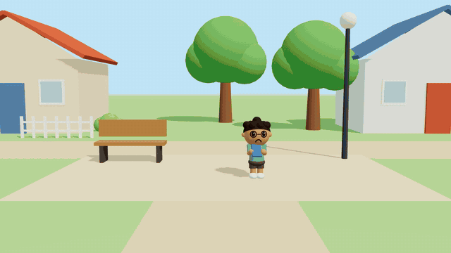
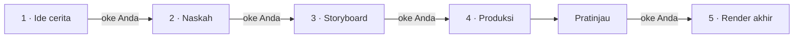

# Toon Crew

[English](README.md) · **Bahasa Indonesia**

**Anda sutradaranya. Kru AI yang membuat filmnya.**

Toon Crew mengubah Claude Code menjadi kru produksi untuk serial animasi Anda sendiri. Anda cukup bilang apa yang Anda mau dengan kata-kata biasa; kru menulis naskah, membuat storyboard, merancang karakter, membangun dunia, merekam suara, menganimasikan adegan, dan memeriksa hasil kerjanya sendiri. Karakter, dunia, dan suara tiap karakter tetap sama dari episode ke episode.

Semuanya dibuat dengan kode di komputer Anda. Tanpa generator video, tanpa aset stok.

> **Status: masih awal.** Kru, mesin animasi, gaya 3D, dan satu serial contoh ("Ada & Ben", satu episode 39 detik) sudah jalan dan sudah diuji di Mac Apple Silicon. Mode cepat dan format tegak sudah dicoba oleh sesi baru yang hanya diberi satu kalimat ide (dua video 17 sampai 19 detik; yang kedua jadi dalam sekitar lima menit dengan dua kali berhenti, di komputer yang alat dan model suaranya sudah terpasang). Pemasangan lewat sistem plugin dari GitHub belum diuji.



## Coba dalam satu kalimat

Buka folder kosong di Claude Code, lalu tulis misalnya:

> *"Buatkan kartun 30 detik untuk TikTok tentang dua sahabat yang bolanya tersangkut di pohon."*

Sebelum membuat apa pun, kru menanyakan empat hal: **ceritanya** (siapa tokohnya, apa yang terjadi), **tempat unggahnya**, **tokohnya seperti apa**, dan **latarnya seperti apa**. Yang sudah Anda sebut di pesan pertama tidak ditanyakan lagi. Untuk tokoh dan latar, jawaban "terserah" sah: baru saat itu kru mengusulkannya. Adegan dan dialog selalu ditulis kru untuk Anda setujui; Anda tidak perlu menulis naskah. Durasi (sekitar 30 detik) dan bahasa (bahasa Anda) punya bawaan. Setelah itu kru mengirim usulan serial beserta ide cerita episode pertama, lalu mengerjakannya tahap demi tahap: naskah, storyboard, dan pratinjau, masing-masing menunggu oke Anda sebelum video dirender.

## Apa bedanya

- **Serial, bukan sekadar klip.** Pemeran tetap, satu dunia dengan peta, dan satu suara tetap per karakter. Episode 5 tampak dan terdengar seperti episode 1.
- **Anda tetap sutradara.** Tiap episode melewati ide → naskah → storyboard → produksi → render akhir, dan kru menunggu persetujuan Anda di tiap tahap.
- **Jalur cepat kalau Anda mau.** Bilang *"jalur cepat"* dan kru hanya berhenti dua kali: sekali untuk seluruh rencana dan sekali untuk hasil gambarnya.
- **Lebar atau tegak.** 16:9 untuk YouTube, atau 9:16 untuk TikTok, Reels, dan Shorts, dengan balon dialog dan teks yang ukurannya pas di layar ponsel.
- **Memeriksa dirinya sendiri.** Quality Control membaca tiap naskah, storyboard, dan daftar dialog sebelum Anda melihatnya, dan tiap rekaman didengarkan ulang. Gambar cukup dilihat sekilas (seluruh episode dalam satu board); gerak dan detail Anda nilai sendiri di pratinjau.
- **Tidak perlu bisa pemrograman.** "Kasih Bimo kacamata." "Taruh sekolah di ujung timur jalan." "Adegan 3 butuh musik yang tegang."

## Alur membuat episode

Setiap episode melewati lima tahap yang sama. Anda mereview setiap tahap sebelum tahap berikutnya dimulai, dan video baru dirender setelah Anda menyetujui pratinjaunya.



| Tahap | Yang dibuat kru | Diperiksa sebelum Anda lihat | Yang Anda review |
|---|---|---|---|
| **1. Ide cerita** | Inti cerita, siapa tokohnya, di mana terjadinya, durasi, dan apa saja yang perlu dibuat baru (tokoh, tempat, musik) | | Apakah idenya sudah tepat? |
| **2. Naskah** | Setiap adegan, setiap baris dialog dan narasi, perkiraan durasi | Quality Control | Apakah ceritanya sudah benar? Apakah tokohnya bicara sesuai wataknya? |
| **3. Storyboard** | Tabel shot: tempat, waktu, kamera, siapa melakukan apa, musik dan efek suara | Quality Control | Apakah begini cara Anda ingin adegannya diambil? |
| **4. Produksi → pratinjau** | Dialog direkam, adegan dianimasikan mengikuti rekamannya, satu gambar seluruh episode, dan tautan pratinjau | Quality Control membaca dialog sebelum direkam; tiap rekaman didengarkan ulang; kru melihat seluruh episode | Putar di pratinjau: apakah tampilan dan suaranya sudah pas? |
| **5. Render akhir** | File video, plus gambar sampul, judul, takarir, dan tagar kalau Anda mau | | |

- Di episode pertama serial baru, ide cerita datang dalam usulan yang sama dengan serialnya (judul, gaya, suara, apa saja yang akan dipasang).
- Perubahan yang Anda minta dikerjakan dan ditunjukkan lagi sebelum lanjut ke tahap berikutnya. Kalau cerita harus berubah di tengah produksi, kru berhenti dan bertanya.
- Tokoh dan tempat baru ditunjukkan untuk Anda setujui tersendiri. Apa pun yang memasang perangkat lunak, berbayar, atau mengirim kata-kata Anda ke layanan luar selalu ditanyakan terpisah.
- **Sedang buru-buru?** Bilang *"jalur cepat"* (fast track): ide, naskah, dan storyboard dikirim sebagai satu rencana dengan satu oke, lalu berhenti berikutnya di pratinjau.

## Pasang

Toon Crew adalah plugin Claude Code. Di Claude Code:

```
/plugin marketplace add silogos/toon-crew
```

```
/plugin install toon-crew@toon-crew
```

Lalu buka folder kosong dan ketik `/toon-crew:toon-crew`, atau langsung bilang apa yang ingin Anda buat.

**Yang dibutuhkan:** Claude Code dan koneksi internet. Node.js 20+ dan Google Chrome dipasangkan oleh kru setelah bertanya satu kali (ffmpeg sudah ikut Remotion).

## Suara

Ada tiga cara merekam suara, dipilih per serial:

- **Lokal dan gratis:** model suara terbuka di Mac Apple Silicon. Tidak ada yang keluar dari komputer Anda. Unduhan pertama beberapa gigabyte.
- **ElevenLabs:** komputer apa saja, dengan kunci API ElevenLabs milik Anda. Berbayar, dan tiap kalimat dialog dikirim ke ElevenLabs.
- **edge-tts (pilihan terakhir, gratis):** komputer apa saja, tanpa akun. Tidak resmi sehingga bisa berhenti bekerja, suara dipilih dari daftar tetap, dan tiap kalimat dikirim ke Microsoft.

## Yang perlu Anda tahu

- Kru tidak bisa mendengar dan tidak bisa menonton gerak. Ia memeriksa gambar dan transkrip; keseimbangan suara, cara bicara, dan rasa tempo tetap butuh mata dan telinga Anda. Karena itu tiap permintaan review disertai tautan pratinjau.
- Baru gaya 3D yang tersedia, dan belum ada set dalam ruangan.
- Kru tidak mengunggah apa pun. Setelah video jadi, ia menawarkan gambar sampul, judul, takarir, dan tagar; mengunggah tetap Anda yang lakukan.

## Lanjut baca

Panduan langkah demi langkah, cara kerja, dan panduan sutradara saat ini berbahasa Inggris: [Getting started](docs/getting-started.md) · [How it works](docs/how-it-works.md) · [Director's Guide](skills/toon-crew/template/DIRECTOR-GUIDE.md).
