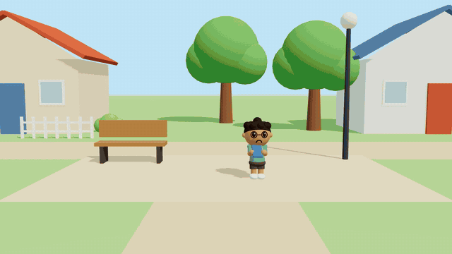
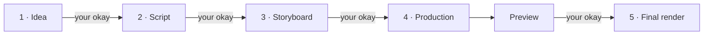
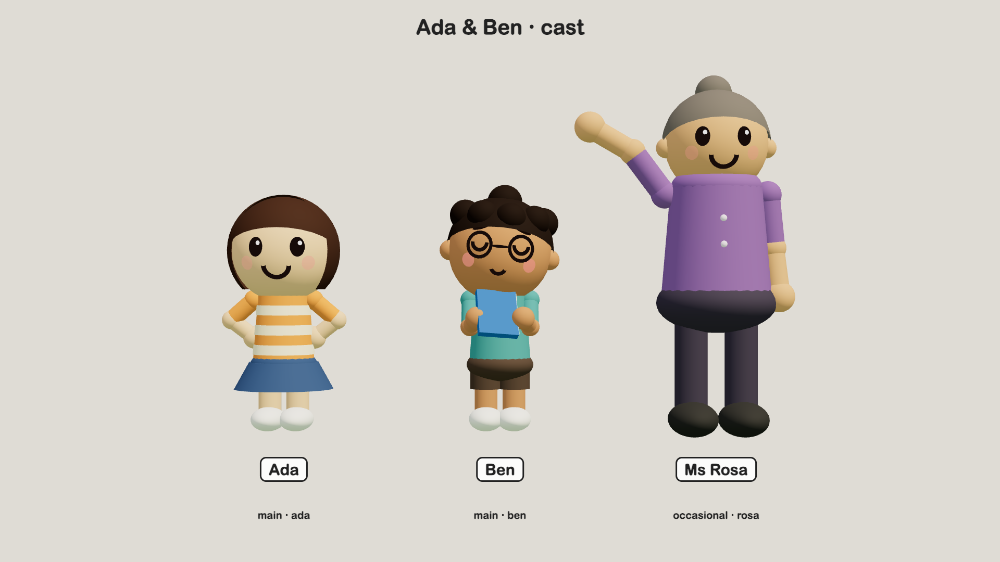
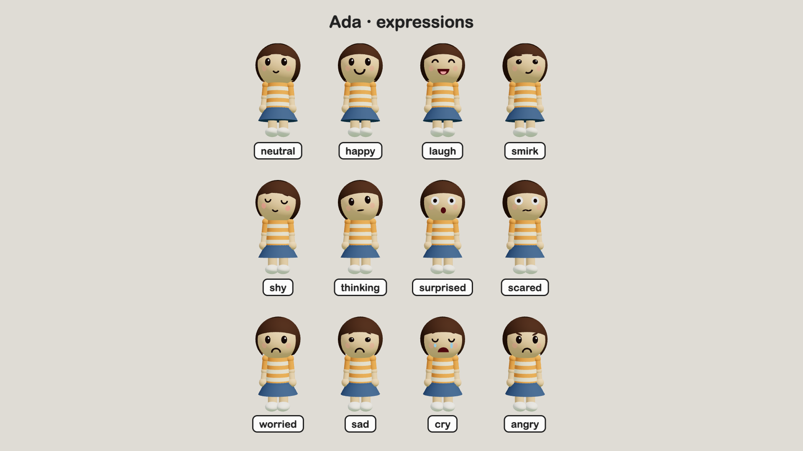
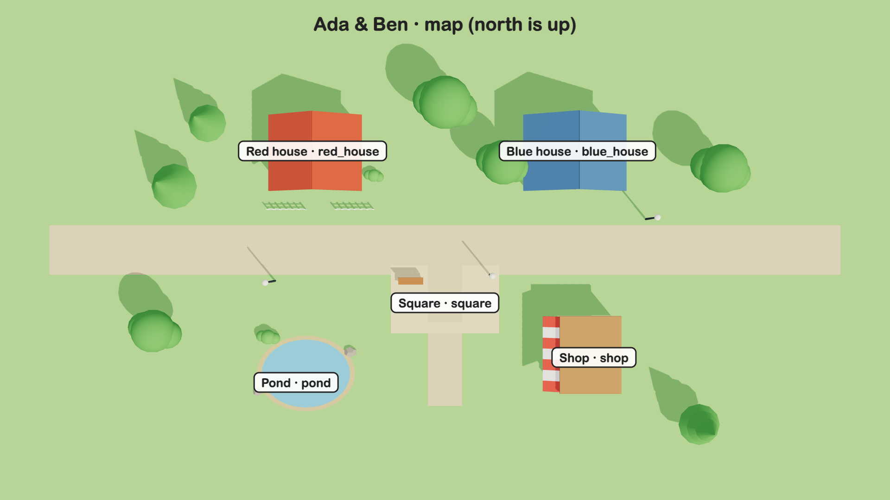
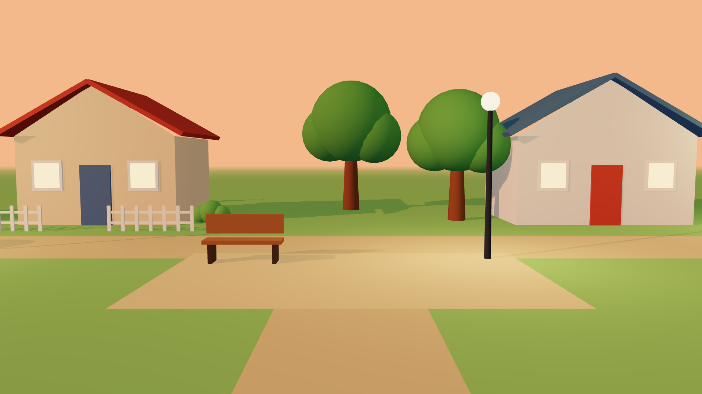

# Toon Crew

**English** · [Bahasa Indonesia](README.id.md)

**You direct. An AI crew makes the show.**

Toon Crew turns Claude Code into the production crew of your own animated series. You say what you want in plain words; the crew writes the script, draws the storyboard, designs the characters, builds the world, records the voices, animates the scenes, and checks its own work. Your characters, your world and every character's voice stay the same from episode to episode.

Everything is made by code on your own computer. No video generator, no stock assets.

> **Status: early.** The crew, the engine, the 3D look and a sample series ("Ada & Ben", one 39-second episode) work, and setting up from a clean copy has been tested on an Apple Silicon Mac. The fast track and vertical video were each tried by fresh sessions working from a one-sentence idea (two 17 to 19 second videos, the second in about five minutes with two stops, on a computer where the tools and the voice model were already installed). Installing through the plugin system from GitHub has not been tested yet. See [Roadmap](#roadmap).



*The sample series, "Ada & Ben": 39 seconds, written, voiced, animated and checked by the crew. [Watch with sound](docs/media/ep01-the-lost-book.mp4).*

## What makes it different

- **A series, not a clip.** A persistent cast, one world with a map, and a fixed voice per character. Episode 5 looks and sounds like episode 1.
- **You stay the Director.** Every episode goes brief → script → storyboard → production → final render, and the crew stops for your okay at each stage.
- **A fast track when you want it.** Say *"fast track"* and the crew comes back only twice: once with the whole plan and once with the finished picture.
- **Landscape or vertical.** 16:9 for YouTube, or 9:16 for TikTok, Reels and Shorts, with speech balloons and captions sized for a phone.
- **A crew, not a prompt.** Writer, Storyboard Artist, Character Designer, Art Director, Animator, Voice Director, Composer, Editor and Quality Control, each with a recipe to follow. Quality Control and the Voice Director run as separate subagents.
- **It checks itself.** Quality Control reads every script, storyboard and set of lines before you see them, and every recorded line is listened back to. The picture gets one quick look (the whole episode on one board); you judge motion and detail in the preview.
- **No programming needed.** "Give Tobi glasses." "Put a school at the east end of the road." "Scene 3 needs something tense."

## How it works

```
your idea ─▶ script ─▶ voices ─▶ timing ─▶ animation ─▶ video
              you approve each stage along the way
```

The length of each recorded line sets the timing of the animation, so a scene is always in sync with its dialogue. Pictures are React components rendered frame by frame with Remotion; 3D uses three.js with every model built from basic shapes.

## Making an episode

Every episode goes through the same five stages. You review each one before the next begins, and the video is rendered only after you have okayed the preview.



| Stage | What the crew makes | Checked before you see it | What you review |
|---|---|---|---|
| **1. Idea** | The point of the story, who is in it, where it happens, the length, and anything new to build (a character, a place, music) | | Is this the right idea? |
| **2. Script** | Every scene, every line of dialogue and narration, the running time | Quality Control | Is the story right? Do the characters sound like themselves? |
| **3. Storyboard** | A table of shots: place, time of day, camera, who does what, music and sound | Quality Control | Is this how you want it filmed? |
| **4. Production → preview** | The lines recorded, the scenes animated in time with their recordings, one picture of the whole episode, and a preview link | Quality Control reads the lines before recording; every take is listened back to; the crew looks at the whole episode | Play it in the preview: does it look and sound right? |
| **5. Final render** | The video file, and a cover picture, title, caption and tags if you want them | | |

- In the first episode of a new series, the idea comes in the same proposal as the series itself (title, look, voices, what will be installed).
- A change you ask for is made and shown again before the next stage. If the story has to change during production, the crew stops and asks.
- New characters and places are shown to you for their own okay. Anything that installs software, costs money or sends your words to an outside service is always asked separately.
- **In a hurry?** Say *"fast track"*: the idea, script and storyboard arrive as one plan with one okay, and the next stop is the preview.

## Install

Toon Crew is a Claude Code plugin. In Claude Code:

```
/plugin marketplace add silogos/toon-crew
```

```
/plugin install toon-crew@toon-crew
```

Then open an empty folder in Claude Code and type `/toon-crew:toon-crew`, or just say what you want:

> *"Make me a 30-second cartoon for TikTok about two friends who get their ball stuck in a tree."*

A step-by-step walkthrough is in [docs/getting-started.md](docs/getting-started.md).

The crew asks for what it needs first (the story, and where you will post it), shows you one proposal, and after your okay sets up an empty studio in that folder and makes your series. Nothing in it comes from a template: the characters, the places and the story are yours.

<details>
<summary>Install without the plugin system</summary>

```bash
git clone https://github.com/silogos/toon-crew
```

```bash
mkdir -p ~/.claude/skills && ln -s "$(pwd)/toon-crew/skills/toon-crew" ~/.claude/skills/toon-crew
```

Then type `/toon-crew` in an empty folder.

</details>

**Requirements:** Claude Code and an internet connection. Node.js 20+ and Google Chrome are installed by the crew for you, after asking once (ffmpeg comes with Remotion). No voice engine is needed until your first script is approved.

**Recording new voices** works three ways, chosen per series:

- **Local and free:** an open voice model on an Apple Silicon Mac. Nothing leaves your computer.
- **ElevenLabs:** any computer (Windows, Linux, Mac), with your own ElevenLabs API key. It uses your ElevenLabs credits and sends each line of dialogue to ElevenLabs.
- **edge-tts (last resort, free):** any computer, no account. Unofficial, so it can stop working; voices are chosen from a fixed list; each line is sent to Microsoft.

The crew asks which you prefer at the first meeting and sets it up. Recordings made elsewhere can be brought in with `npm run voices:import`.

## What is in this repository

| Path | What it is |
|---|---|
| `skills/toon-crew/SKILL.md` | The front door: first meeting and studio setup |
| `skills/toon-crew/scripts/setup-studio.mjs` | Puts the studio into your folder in one step, without overwriting anything |
| `skills/toon-crew/references/tech-stack.md` | Which technology the crew recommends for each look, and why |
| `skills/toon-crew/template/` | The studio that is copied into your series folder |
| `…/template/CLAUDE.md` | The crew's standing rules |
| `…/template/DIRECTOR-GUIDE.md` | What you can ask for, in plain words |
| `…/template/agents/` | Subagents: `quality-control`, `voice-director` |
| `…/template/scripts/` | What the crew runs: stills, render, preview, voices, music, the content check, `status` (where the production stands) and `doctor` (what the computer is missing) |
| `…/template/skills/` | One recipe per job: `/new-character` (from code, or from a 3D model file), `/new-place`, `/new-episode`, `/opening`, `/voices`, `/music`, `/screening`, `/render` |

## Gallery

| | |
|---|---|
|  The cast, side by side |  One character's twelve expressions |
|  The world from above |  The same square at dusk |

New here? [Getting started](docs/getting-started.md). Want more detailed characters? [Characters from 3D model files](docs/models.md) (optional). Everything you can ask for: the [Director's Guide](skills/toon-crew/template/DIRECTOR-GUIDE.md). How it fits together: [docs/how-it-works.md](docs/how-it-works.md).

## Roadmap

- [x] Crew: rules, subagents, recipes, Director's guide
- [x] Engine: timeline, episode assembly, balloons and captions, voice and music scripts, stills and render
- [x] 3D look: stage, camera, light, characters, building blocks, world map
- [x] Sample series that shows what the studio makes ("Ada & Ben", episode 1); a new studio starts empty and gets it only on request
- [x] Installs as a Claude Code plugin
- [x] Fast track: one okay on the plan, one on the finished picture
- [x] Vertical video (9:16): text sized and placed for phones
- [x] Voices on Windows and Linux through ElevenLabs (not yet tested against the live service)
- [ ] Free local voices on Windows and Linux
- [ ] 2D and 2.5D looks

## Licence

MIT. Toon Crew builds on [Remotion](https://www.remotion.dev/), which is free for individuals and small teams and needs a company licence above that size.
